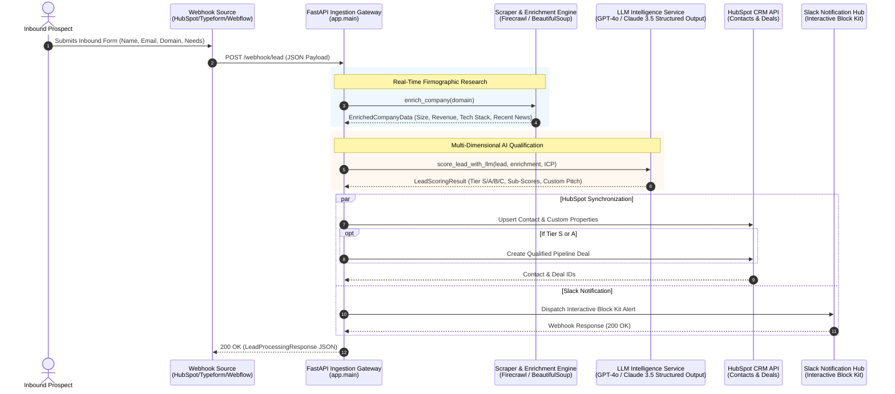

# Enterprise AI Lead Scoring & Enrichment Engine

[](https://fastapi.tiangolo.com)
[](https://docs.pydantic.dev/)
[](https://platform.openai.com)
[](https://developers.hubspot.com/)
[](https://api.slack.com/block-kit)
[](https://www.docker.com/)
[](LICENSE)

> **Autonomous Inbound Revenue Acceleration Pipeline for Enterprise B2B SaaS & RevOps Teams.**  
> Built and architected by an **Enterprise AI Architect** to eliminate manual qualification friction and scale speed-to-lead under 60 seconds.

---

## 1. Executive Summary

In high-growth B2B enterprise sales, **speed-to-lead** is the single greatest determinant of pipeline conversion. Research by *Harvard Business Review* and *InsideSales* proves that responding to an inbound inquiry within **5 minutes** yields a **9x increase in qualified discovery meetings** compared to standard 30-minute SDR response times.

Yet, traditional sales workflows are plagued by manual qualification lag:
* Reps waste 15–30 minutes per lead manually digging through LinkedIn, Crunchbase, and company websites.
* Low-intent leads and spam overwhelm the Account Executive (AE) calendar.
* High-intent, tier-1 enterprise prospects sit idle in CRM queues during peak buying motivation.

**Enterprise AI Lead Scoring & Enrichment Engine** solves this systemic RevOps bottleneck. The moment a prospect submits a web form or demo request:
1. **Instant Firmographic Enrichment**: Crawls and extracts company scale, technology stack, and business model in milliseconds.
2. **Deterministic LLM Qualification**: Leverages `GPT-4o` / `Claude 3.5 Sonnet` via **Structured Outputs** to score the lead against Ideal Customer Profile (ICP) criteria, assigning a priority tier (**Tier S, A, B, C**).
3. **Automated Pitch Synthesis**: Writes tailored value propositions, email subject lines, and tactical talking points customized to the prospect's exact pain points.
4. **Autonomous CRM & Slack Orchestration**: Instantly syncs enriched records and deal stages to **HubSpot CRM** while pushing an interactive, actionable **Slack Block Kit** alert directly to assigned sales reps.

---

## 2. Architecture & Data Flow



---

## 3. Key Architectural Features

### 🏢 Real-Time Company Enrichment
* **Multi-Layer Data Acquisition**: Integrates with **Firecrawl API** for deep content parsing with automatic fallback to high-speed asynchronous `httpx` + `BeautifulSoup` live scraping.
* **Domain Normalization**: Sanitizes URLs, handles subdomains, and strips redirects automatically.
* **Firmographic Extraction**: Resolves canonical company name, estimated employee range, annual revenue scale, primary tech stack, and key market offerings.
* **Zero-Downtime Deterministic Fallback**: Built-in benchmark intelligence for zero-latency testing and reliable sandbox demonstrations.

### 🧠 LLM-Based Structured Lead Scoring
* **Native Structured Outputs**: Guarantees 100% type-safe JSON schema enforcement using Pydantic v2 and OpenAI's `client.beta.chat.completions.parse` / Anthropic Tool Calling.
* **Multi-Dimensional Qualification Rubric**:
  * **ICP Fit Score (0–100)**: Evaluates industry match, headcount threshold (50–5,000), and revenue scale.
  * **Intent Urgency Score (0–100)**: Detects immediate buying triggers, budget mentions, implementation timelines, and acute operational pain points.
  * **Budget & Authority Score (0–100)**: Identifies executive sponsorship probability and economic buyer authority.
* **Tier Categorization Matrix**:
  | Tier | Score Range | Classification | Prescribed RevOps Action |
  | :--- | :---: | :--- | :--- |
  | **Tier S** | `90 - 100` | Enterprise Flagship | **Immediate Senior AE Outreach (< 5 min)** + Deal Created |
  | **Tier A** | `75 - 89` | Strong Mid-Market ICP | **Priority SDR Qualification** + Deal Created |
  | **Tier B** | `50 - 74` | Emerging / Generic | **Automated Email Nurture Sequence** |
  | **Tier C** | `0 - 49` | Student / Job / Mismatch | **Disqualified / Self-Serve Referral** |

### 🎯 Automated Sales Pitch Generation
* Prevents SDR "writer's block" by generating rep-ready collateral within the payload:
  * **Personalized Email Subject Line**: High open-rate hooks referencing their specific operational bottleneck.
  * **Value Proposition**: 2-sentence tailored impact statement.
  * **Tactical Talking Points**: Three bespoke discovery talking points tailored to their tech stack and scale.
  * **Low-Friction Call-to-Action**: Tailored next-step prompt.

### 💬 Interactive Slack Block Kit Notifications
* Custom-crafted Slack alerts render immediately in team channels (e.g., `#sales-inbound-urgent`):
  * Dynamic visual tier badges (`🔥 Tier S`, `🚀 Tier A`, `ℹ️ Tier B`)
  * Two-column breakdown of contact details, headcount, and total score
  * Micro-metric progress scores for ICP Fit, Intent, and Budget
  * Quoted inbound message and AI Executive Briefing
  * **Interactive Action Buttons**: `⚡ Claim Lead`, `📊 Open in HubSpot`, `📅 Schedule Discovery`

---

## 4. Project Structure

```
ai-lead-scoring/
├── .env.example              # Environment variables template
├── .gitignore                # Git ignore patterns
├── Dockerfile                # Production-grade container definition
├── docker-compose.yml        # Multi-container orchestration
├── pyproject.toml            # Project specifications & metadata
├── requirements.txt          # Python dependencies
├── README.md                 # System documentation & architectural brief
│
├── app/
│   ├── __init__.py
│   ├── main.py               # FastAPI gateway, routes, and exception handling
│   │
│   ├── core/
│   │   ├── __init__.py
│   │   ├── config.py         # Pydantic Settings management
│   │   └── logger.py         # Structured logging configuration
│   │
│   ├── schemas/
│   │   ├── __init__.py
│   │   ├── webhook.py        # Inbound webhook payload schema
│   │   ├── enrichment.py     # Corporate intelligence firmographics schema
│   │   ├── scoring.py        # Qualification rubric & sales pitch schema
│   │   └── response.py       # Unified API response schema
│   │
│   └── services/
│       ├── __init__.py
│       ├── scraper.py        # Web scraping & Firecrawl enrichment engine
│       ├── llm_scorer.py     # OpenAI/Anthropic structured evaluation engine
│       ├── hubspot.py        # HubSpot CRM v3 Contacts & Deals integration
│       └── slack.py          # Slack Block Kit notification constructor
│
├── scripts/
│   ├── test_webhook.py       # CLI runner to trigger realistic test leads
│   └── sample_payloads.json  # Pre-configured test datasets (Tier S, A, B, C)
│
└── tests/
    ├── __init__.py
    └── test_api.py           # Pytest suite for API endpoints & pipeline
```

---

## 5. Tech Stack

| Component | Technology | Purpose |
| :--- | :--- | :--- |
| **Backend Framework** | **Python 3.10+ / FastAPI** | High-performance asynchronous API framework |
| **Data Validation** | **Pydantic v2 & Pydantic-Settings** | Strict data modeling and environment handling |
| **Scraping Engine** | **Firecrawl API / BeautifulSoup4 / HTTPX** | Real-time web intelligence extraction |
| **AI Orchestration** | **OpenAI (`gpt-4o`) / Anthropic (`claude-3-5-sonnet`)** | Structured output qualification & pitch authoring |
| **CRM Integration** | **HubSpot REST API v3** | Automatic contact syncing and deal creation |
| **Notification Hub** | **Slack API / Block Kit Builder** | Rich interactive sales alerts with actionable buttons |
| **Testing & Quality** | **Pytest / Pytest-Asyncio** | End-to-end integration and endpoint validation |
| **Containerization** | **Docker & Docker Compose** | Reproducible enterprise deployment |

---

## 6. Getting Started & Installation

### Step 1: Clone Repository
```bash
git clone https://github.com/knmgn/ai-lead-scoring.git
cd ai-lead-scoring
```

### Step 2: Configure Environment
Copy `.env.example` to `.env`:
```bash
cp .env.example .env
```

Edit `.env` with your preferred credentials:
```env
# AI Provider Settings ("openai" or "anthropic")
LLM_PROVIDER="openai"
OPENAI_API_KEY="sk-your-openai-api-key"
OPENAI_MODEL="gpt-4o"

# CRM & Notifications (Optional: runs in simulation mode if empty)
HUBSPOT_ACCESS_TOKEN="pat-na1-your-hubspot-token"
HUBSPOT_PORTAL_ID="12345678"
SLACK_WEBHOOK_URL="https://hooks.slack.com/services/T00/B00/XXXX"
```

> **Note on Zero-Config Demo Mode:**  
> If API keys for OpenAI, Anthropic, HubSpot, or Slack are not supplied, the engine automatically runs in **Resilient Simulation Mode**. You can execute and demo the entire pipeline out-of-the-box without external accounts!

### Step 3: Install Dependencies
```bash
# Recommended: Create a virtual environment
python -m venv .venv
source .venv/bin/activate  # On Windows: .venv\Scripts\activate

# Install requirements
pip install -r requirements.txt
```

### Step 4: Run Application
```bash
uvicorn app.main:app --reload --port 8000
```
The server will boot at `http://localhost:8000`.  
Explore the interactive **Swagger UI** documentation at `http://localhost:8000/docs`.

---

## 7. Execution & Verification

### Method A: Interactive CLI Test Runner
Run pre-configured test scenarios using the included CLI script:

```bash
# Test Tier S Flagship Enterprise Lead (Stripe)
python scripts/test_webhook.py --tier s

# Test Tier A High-Priority Mid-Market Lead
python scripts/test_webhook.py --tier a

# Test Tier C Disqualified Inbound (Job Seeker / Student)
python scripts/test_webhook.py --tier c

# Test all scenarios in sequence
python scripts/test_webhook.py --tier all
```

### Method B: cURL Webhook Ingestion
```bash
curl -X POST "http://localhost:8000/webhook/lead" \
  -H "Content-Type: application/json" \
  -d '{
    "name": "Sarah Jenkins",
    "email": "sarah.jenkins@stripe.com",
    "company_domain": "stripe.com",
    "company_name": "Stripe",
    "message": "We need to automate our inbound lead triage pipeline across North America urgently before Q4."
  }'
```

### Method C: One-Click Swagger Simulation
Navigate to `http://localhost:8000/docs` and execute `POST /demo/simulate/{preset}` with `tier_s` or `tier_a`.

---

## 8. Sample Output Payload

```json
{
  "success": true,
  "lead_id": "lead_a3f8902cde",
  "processed_at": "2026-10-15T06:30:00Z",
  "lead": {
    "name": "Sarah Jenkins",
    "email": "sarah.jenkins@stripe.com",
    "company_domain": "stripe.com",
    "company_name": "Stripe",
    "message": "We need to automate our inbound lead triage pipeline across North America urgently."
  },
  "enrichment": {
    "company_name": "Stripe",
    "domain": "stripe.com",
    "industry": "Financial Technology & Payment Infrastructure",
    "employee_range": "5,000 - 10,000",
    "estimated_revenue": "$14B+",
    "tech_stack": ["AWS", "Ruby", "React", "Kafka", "Kubernetes"],
    "source": "Enterprise Knowledge Graph (Curated)"
  },
  "scoring": {
    "score_tier": "S",
    "total_score": 96,
    "icp_fit_score": 98,
    "intent_urgency_score": 95,
    "budget_authority_score": 95,
    "company_summary": "Stripe is a global financial infrastructure platform powering internet payments for millions of businesses.",
    "evaluation_rationale": [
      "Flawless ICP match with enterprise headcount (5,000+) and $14B+ revenue scale.",
      "Clear intent statement addressing speed-to-lead and pipeline leakage.",
      "Urgent procurement timeline signaled for Q4."
    ],
    "recommended_sales_pitch": {
      "subject_line": "Accelerating Stripe's inbound enterprise pipeline velocity",
      "value_proposition": "Enable Stripe's revenue team to eliminate lead qualification latency and engage Tier-1 prospects within 60 seconds.",
      "key_talking_points": [
        "Eliminate 25% revenue leakage attributed to SDR qualification delay",
        "Seamlessly integrate with HubSpot CRM and enterprise Slack channels",
        "Automate deep firmographic scraping without human rep intervention"
      ],
      "recommended_cta": "Propose a 15-minute technical discovery call with an Enterprise AI Architect."
    },
    "suggested_action": "IMMEDIATE_AE_OUTREACH",
    "routing_priority": "URGENT"
  },
  "integrations": {
    "hubspot_synced": true,
    "hubspot_contact_id": "hs_cnt_4819201",
    "hubspot_deal_id": "hs_deal_9381024",
    "slack_notified": true,
    "slack_channel": "live_webhook",
    "execution_notes": "CRM: live_hubspot_api | Slack: live_webhook | LLM: openai"
  }
}
```

---

## 9. Running with Docker

Deploy seamlessly across staging or production environments using Docker:

```bash
# Build and start container
docker-compose up --build -d

# View live container logs
docker-compose logs -f

# Check health
curl http://localhost:8000/health
```

---

## 10. Enterprise Production Considerations

For enterprise scale (>50,000 inbound submissions per month), this pipeline easily decouples into distributed microservices:
1. **Asynchronous Task Queuing**: Wrap the `/webhook/lead` endpoint with **Celery + Redis** or **AWS SQS** for non-blocking sub-millisecond HTTP 202 acceptance.
2. **HMAC Webhook Verification**: Implement cryptographic signature validation (e.g., `X-HubSpot-Signature`) to guarantee sender authenticity.
3. **Multi-Model Fallback Circuit Breaker**: Auto-switch from OpenAI `gpt-4o` to Anthropic `claude-3-5-sonnet` if latency exceeds 2,500ms or rate limits trigger.
4. **Data Privacy & GDPR**: Enforce PII masking before dispatching web research prompts to external LLM providers.

---

## 11. Author & Enterprise AI Architecture Inquiries

This project was conceived, designed, and developed by an **Enterprise AI Architect & RevOps Automation Specialist**.

### Services Provided for Enterprise Clients on Upwork:
* **Custom AI Revenue Architectures**: Inbound lead triage, AI SDR agents, and dynamic qualification workflows.
* **LLM Pipeline Engineering**: Structured Outputs, RAG architectures, and multi-agent systems with LangGraph / LlamaIndex.
* **Enterprise CRM & Data Integrations**: Deep bidirectional synchronizations with HubSpot, Salesforce, Slack, Segment, and Snowflake.
* **Production Deployments**: AWS (ECS, Lambda, Bedrock), GCP (Cloud Run, Vertex AI), and Kubernetes.

💼 **Available for freelance consulting & enterprise contracts on Upwork.**  
Feel free to open an issue or reach out directly to discuss your enterprise AI architecture roadmap!

---

## 12. License
Distributed under the MIT License. See `LICENSE` for details.
